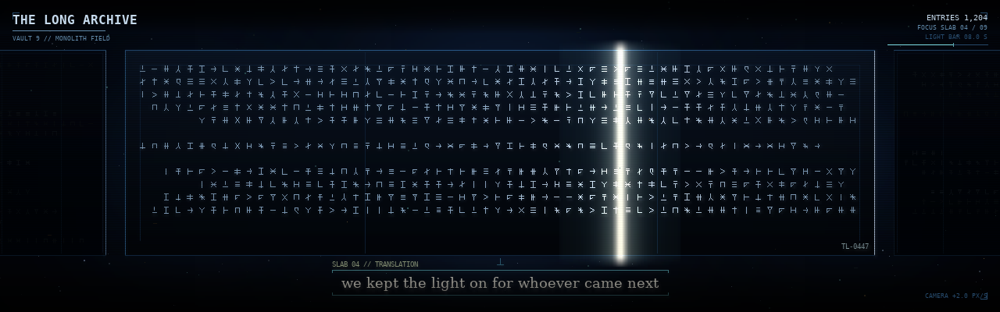
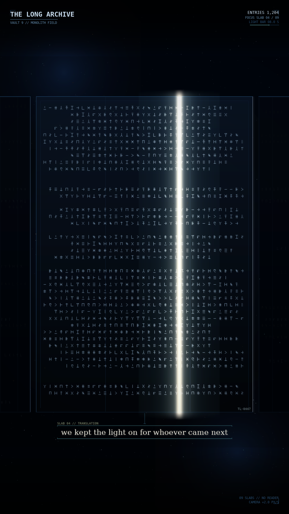
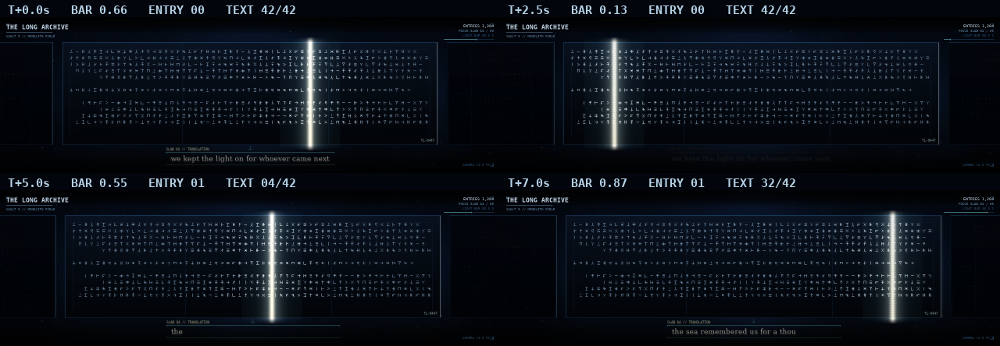

# The Long Archive — implemented

**Status:** built, registered and validated. The art review in
`screenshots/long_archive/` is the reference; the live mode is in
`modes/long_archive_mode.py` plus the `long_archive/` scene package.

**Source:** `designs/SLOW_WORLDS_DESIGN.md` §5.7 (wave 3). Closest existing modes:
`cosmiclibraryindex` (a console) and `imaginarylibrary` (an interior). This is an exterior
monument in the dark: no floor, no shelves, no reader.

## 1. The approved frame

| | |
|---|---|
|  |  |
| `screenshots/long_archive/hero_1280x400.png` | `screenshots/long_archive/hero_1080x1920.png` |

A 16:9 still is generated as `screenshots/long_archive/hero_1920x1080.png`; it uses the same
landscape wall at 1440 px active width. No separate 16:9 profile instance was added.

| Four moments of the strip |
|---|
|  |
| `screenshots/long_archive/motion_sheet.png` — T+0 s hold, T+2.5 s fade, T+5 s new entry, T+7 s reveal |

- **Wall:** every slab is frontal and coplanar, with a common top line, a common bottom line
  and equal gaps. The active slab is **75% of the display width** (960 px of 1280; 810 px of
  1080). One narrow neighbour sits at each edge, its outer half off-frame so the wall continues
  past the camera. No depth scatter, tilt or per-slab height difference.
- **Palette:** `bone` is the reviewed set — near-black blue, cold structure, bone-white line,
  one amber catalogue mark. `amber` (Ember & Rust) and `verdigris` (Phosphor & Ash) are variants.
- **Light:** a vertical light bar bounces across the active slab, bone-white core with a teal
  falloff, waking the glyphs it passes.
- **Translation:** one line resolves below the slab at `text_speed`, holds, fades, and the next
  entry takes over. The bracket, leader and `SLAB 04 // TRANSLATION` label are the only
  annotation; the lower-left 80×32 stays clear for the controller's mode number.
- **HUD:** the reviewed still is `hud: "full"` — title, subtitle, entries, focus, bar clock,
  thin progress track and a camera footer. `minimal` drops the subtitle/footer; `off` leaves
  the wall and the translation.

## 2. Files

| File | What it is |
|---|---|
| `modes/long_archive_mode.py` | The mode adapter: config validation, seed, lore load, quality controller, lifecycle. |
| `long_archive/palette.py` | Three palettes and the colour helpers. |
| `long_archive/glyphs.py` | Invented script, built-in lore, slab model, deterministic row layout. |
| `long_archive/layout.py` | 75% wall geometry and the responsive type/padding scale. |
| `long_archive/renderer.py` | Cached faces, lit-glyph overlay, bar, caption, motes, bloom, finish. |
| `long_archive/hud.py` | The restrained console. |
| `modes_registry.json` | Type `longarchive` with typed `optional`/`params`. |
| `configs/modes_config_narrow_horz.json` | Slot **22** (the first genuinely free slot). |
| `configs/modes_config_portrait.json` | Slot **27**. |
| `configs/modes_config_vert.json` | Slot **65** (the portrait kiosk's active profile). |
| `tests/test_long_archive.py` | Headless wall/seed/clock/config/wiring tests. |
| `scripts/long_archive_preview.py` | Hero stills + motion sheet from the real profiles. |

**Slots note:** another session had already added Orrery at narrow slot 21 and portrait slot 26
while this mode was being built. Existing slots must not be renumbered, so Long Archive uses
the next free slots (22 / 27 / 65). The other profiles were left untouched.

## 3. Config keys (the registry is the source of truth)

| Key | Default | Notes |
|---|---|---|
| `title` | `THE LONG ARCHIVE` | Header |
| `subtitle` | `VAULT 9 // MONOLITH FIELD` | Full HUD only |
| `seed` | unset | Unset = fresh vault; pinned = reproducible; logged |
| `palette` | `bone` | `bone`, `amber`, `verdigris` |
| `orientation` | `auto` | `auto`, `landscape`, `portrait` |
| `hud` | `full` | `full`, `minimal`, `off` |
| `quality` | `auto` | `auto`, `low`, `medium`, `high` |
| `slab_count` | 9 | 7–12; catalogue readout, the wall shows three |
| `drift_speed` | 2.0 | 0–4 px/s wall sway; 0 holds still |
| `text_speed` | 14 | Translation characters per second, 4–30 |
| `text_file` | unset | Optional JSON list; built-in lore on absence/failure |
| `show_labels` | true | SLAB label and TL-0447 catalogue mark |
| `bar_period` | 8.0 | Full bar bounce, 4–20 s |
| `glow_strength` | 0.55 | 0–1 |
| `scanline_alpha` | 6 | 0–40 |
| `vignette_strength` | 0.42 | 0–1 |

The mode holds the current slab (04) for the whole scene; the signature is carried by the bar
and the cycling translation rather than by moving a bright slab to a different panel. The wall
stays the reviewed composition.

## 4. Renderer and clocks

The renderer caches, per resolution and quality tier: the star/cloud background, the finish
(vignette + scanlines + HUD bands), the bloom surfaces, one face surface per slab, the bar
sprite and the caption lines. A frame blits the background, the three cached faces, then draws
only the glyphs inside the moving bar's reach (the rest are already baked dim), adds the bar,
caption and motes, runs one downscaled additive bloom and the baked finish. The HUD is drawn
after the finish so it stays crisp.

| Element | Behaviour |
|---|---|
| Bar | Triangle sweep across the active slab; 8 s full bounce; starts at 66% so the first frame is the composed hold |
| Translation | Reveal begins at 24% of the cycle at `text_speed`; holds to 86%; fades by 98.5%; next entry on the next cycle |
| Wall sway | ±2% of the width on a 120 s sine, scaled by `drift_speed`; the active slab stays 75% wide |
| Motes | Seeded, 1–3 px/s, behind and in front of the wall; the caption plate stays clear |
| Quality | `low` skips alternating rows and thins motes; `medium` is the full wall at half-res bloom; `high` adds motes and a 4× bloom. Layout and clocks never change |

Determinism comes from seeded `random.Random` plus a stable integer mix, never Python's salted
`hash`. `text_file` is read once in `enter()`, never on the frame loop; missing or malformed
files fall back to the built-in lore and log once.

## 5. Verify

```bash
./.venv/bin/python validate_configs.py --all
SDL_VIDEODRIVER=dummy ./.venv/bin/python -m pytest tests/test_long_archive.py -q
SDL_VIDEODRIVER=dummy ./.venv/bin/python -m pytest tests/ -q

# play it on the strip:
SDL_VIDEODRIVER=dummy ./.venv/bin/python pixel_dreams.py \
    --play 22 --config configs/modes_config_narrow_horz.json \
    --windowed --width 1280 --height 400

# regenerate the review stills:
./.venv/bin/python scripts/long_archive_preview.py
```

Measured render cost on the development host (dummy SDL, high quality): about 11 ms/frame at
1280×400 and 34 ms/frame at 1080×1920. The strip is the Pi target; auto quality has headroom to
drop. `enter()` builds the caches once (about 0.26 s strip / 0.56 s portrait).

## 6. Resolved review decisions

1. **Palette:** `bone` by default; amber and verdigris variants implemented.
2. **Translation placement:** below the slab, as an archival annotation (kept).
3. **Light bar:** vertical sweep (implemented as an 8 s bounce).
4. **Wall composition:** 75% active width, two cropped peripheral neighbours, one plane.
5. **HUD:** the reviewed still's full HUD is the default; minimal/off exposed.
6. **Profiles:** narrow 22, portrait 27, portrait kiosk vert 65. 16:9 uses the same landscape
   layout and is supported by the responsive layout; no separate instance was added yet.
