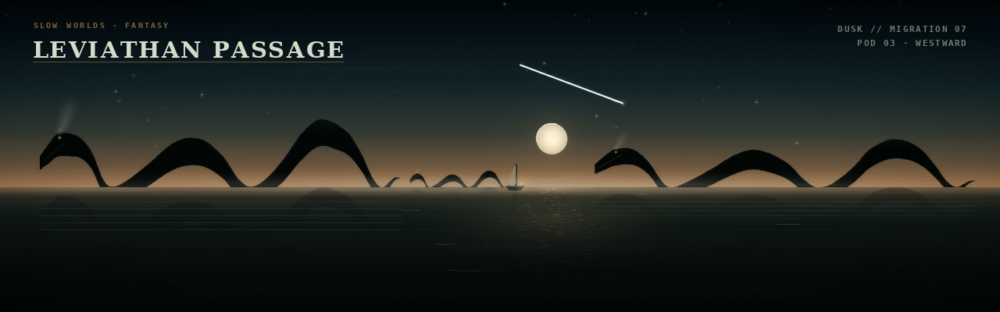
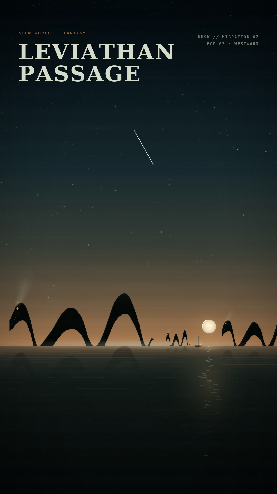
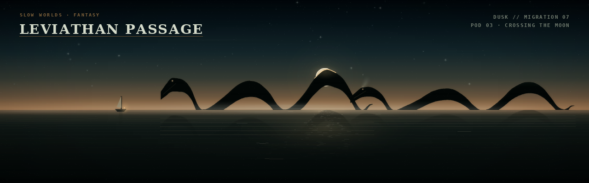
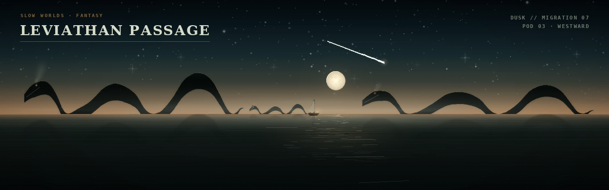
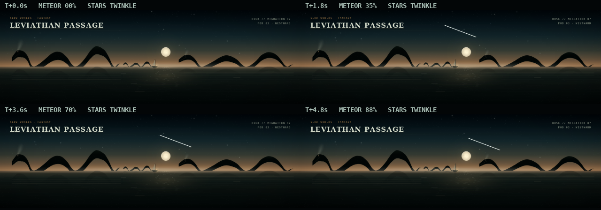

# Leviathan Passage — art direction and implementation plan

Reference: [`SLOW_WORLDS_DESIGN.md` §5.14](../SLOW_WORLDS_DESIGN.md#514-leviathan-passage).

**Status: implemented.** The mode is `modes/leviathan_mode.py` (type
`leviathan` in the registry), with instances at narrow slot **25**, portrait
slot **30** and vert slot **69**. `modes_config.json`, the default profile, was
left alone. This folder still contains the reviewed still generator; the
[tests](../../tests/test_leviathan.py) and the mode previews below are the
implementation check.

The card asks for a dusk sea, a pod of leviathans crossing a low horizon, mist,
a low moon and a small boat for scale — and one signature moment: the largest
leviathan crossing the moon and eclipsing it while the sea keeps moving.

## The design stills

These are the approved art-direction stills, rendered by the design generator:

| File | Size | What it is |
|---|---|---|
| [`../../screenshots/leviathan/leviathan_1280x400.png`](../../screenshots/leviathan/leviathan_1280x400.png) | 1280×400 | the Pi strip; `dusk`, full HUD, a meteor pass |
| [`../../screenshots/leviathan/leviathan_1080x1920.png`](../../screenshots/leviathan/leviathan_1080x1920.png) | 1080×1920 | the portrait wall, re-composed; a meteor pass |
| [`../../screenshots/leviathan/leviathan_1280x400_eclipse.png`](../../screenshots/leviathan/leviathan_1280x400_eclipse.png) | 1280×400 | the signature: the largest hump crosses the moon |
| [`../../screenshots/leviathan/meteor_sheet.png`](../../screenshots/leviathan/meteor_sheet.png) | 1280×448 | four moments of the sky: stars, twinkle and the meteor pass |
| [`../../screenshots/leviathan/palette_study.png`](../../screenshots/leviathan/palette_study.png) | 1280×1290 | `dusk` / `bone` / `ember`, same layout |

The strip:



The portrait:



The signature moment:



### Mode previews

These are rendered by the real mode through
`scripts/leviathan_preview.py`, from the narrow 25 and portrait 30 instances.
The preview pins seed 5140, `quality: high` and `moon_arc_seconds: 0` for a
reproducible frame; the shipped profiles use `auto` and the 600 s moon arc.

| File | Size | What it is |
|---|---|---|
| [`../../screenshots/leviathan/mode_1280x400.png`](../../screenshots/leviathan/mode_1280x400.png) | 1280×400 | the real mode at the strip hero moment |
| [`../../screenshots/leviathan/mode_1080x1920.png`](../../screenshots/leviathan/mode_1080x1920.png) | 1080×1920 | the real mode at the portrait hero moment |
| [`../../screenshots/leviathan/mode_eclipse_1280x400.png`](../../screenshots/leviathan/mode_eclipse_1280x400.png) | 1280×400 | the real mode at the crossing |
| [`../../screenshots/leviathan/mode_1920x1080.png`](../../screenshots/leviathan/mode_1920x1080.png) | 1920×1080 | the 16:9 sanity preset |



Regenerate with:

```bash
SDL_VIDEODRIVER=dummy .venv/bin/python designs/leviathan_proto/gen_leviathan.py
# one target:
SDL_VIDEODRIVER=dummy .venv/bin/python designs/leviathan_proto/gen_leviathan.py --only portrait
SDL_VIDEODRIVER=dummy .venv/bin/python designs/leviathan_proto/gen_leviathan.py --only eclipse
SDL_VIDEODRIVER=dummy .venv/bin/python designs/leviathan_proto/gen_leviathan.py --only meteor
SDL_VIDEODRIVER=dummy .venv/bin/python designs/leviathan_proto/gen_leviathan.py --only palette

# the real mode (narrow 25 / portrait 30 / 16:9 sanity)
SDL_VIDEODRIVER=dummy .venv/bin/python scripts/leviathan_preview.py
```

`gen_leviathan.py` is the approved still generator: it renders at 3×/2× and
downsamples. The mode renders at native resolution and caches the static
layers; `leviathan_preview.py` is the verification path.

## What the two orientations are doing

### The strip (1280×400)

The card's schematic is a band of humps on a horizon. On the Pi strip the still
uses the width as a procession:

- a **pod of three** — two adults and a calf — crosses from the right-facing
  gap; the largest is at the left, the calf follows it, a second adult enters at
  the right;
- the **moon** is low in the gap between the adults, with the **boat** directly
  below it: the two small objects give the scale of the pod;
- the horizon is at **60 %** of the frame: the sea is a narrower calm field and
  the extra sky carries the star field and the meteor;
- the humps break a warm dusk band; the stars and the meteor keep the upper
  frame alive between pod crossings;
- the title sits top-left, the telemetry top-right, and the lower-left 80×32 px
  stays dark for the controller's mode-number watermark;
- the moon's path and the reflected humps do the work in the lower half; the
  reflections are sliced and rippled, not mirrored copies.

### The portrait (1080×1920)

The portrait is a **re-composition, not a crop**:

- the horizon is at **70 %**, leaving a tall sky for the moon, the star field,
  the meteor and the two-line title lockup;
- the pod is larger relative to the width: the largest hump is about 200 px
  tall, and the boat and calf are tiny beneath the moon;
- the moon path is an irregular column down the near water; the reflected
  humps sit under their animals, and the sea is 576 px rather than 768 px;
- the title becomes `LEVIATHAN` / `PASSAGE` in serif, with the eyebrow and
  telemetry in the top corners;
- tall negative space above the pod is deliberate: it is a poster, and the
  horizon is low in the viewer's attention.

## Stars, twinkle and the meteor

The larger sky is the busiest part of the frame between events:

- **Star field.** The strip gets roughly 460 candidate stars and the portrait
  roughly 950, filtered so the warm horizon band and the HUD areas stay quiet.
  Most are 1 px at 26–126 alpha; a few are 2–3 px; seven on the strip and
  sixteen on the portrait are deliberate anchors with a soft halo and a cross
  glint. Every star has a seeded phase and a 3.5–9 s period, so the field
  breathes by a few percent instead of blinking. In the mode the base field is
  cached and only the bright anchors are redrawn per frame.
- **Meteor.** Roughly every 60–120 s (seeded) a single meteor crosses the upper sky for
  0.6–1.4 s: a soft, tapered streak with a hot head and a faint aura, no flash,
  no sound. Its path is seeded and avoids the title, the telemetry and the
  moon. The hero stills pin one pass; the sheet shows it at 0 / 35 / 70 / 88 %
  with the stars twinkling between frames.



The stills are one sky moment; the sheet is the review aid for the animation.
The meteor is an event, not a permanent feature: most of the time the sky is
just the field, the twinkle and the low moon.


The design card says "a bezier spine with a few ribs and a tail; the body moves
as a wave along the spine, not as a sprite". The stills take that literally: a
leviathan is a **serpentine tube** on a sampled spine.

- `SPINE` holds the animal's centre-line in normalized coordinates: a blunt
  head, a submerged neck, two broad humps, a submerged tail base and a whip
  tail. The neck, the dip between the humps and the tail base are below the
  waterline, so the animal reads as separate arches with water between them.
- `THICK` holds the tube diameter: heavy through the humps, thin at the snout
  and the tail. The top and bottom contours are the spine ± half the thickness.
- The body is clipped at the waterline when it is blitted, so the submerged
  sections disappear without a cut polygon edge.
- A **rim light** is drawn only on the moon-facing side of each hump, broken by
  a slow breather. The far side stays dark; the creature never gets a drawn
  outline.
- One **eye** (a dark socket and a warm glint) and a **jaw** line make the head
  read at one metre. There is no mouth, no teeth, no spikes.
- A small **swept-back crest** on the head is the only fantasy flourish. The
  earlier longer horn read as a bird; it was cut.
- The **tail** tapers to a whip and lifts slightly at the tip. It is not a whale
  fluke: a fluke seen from the side is a horizontal blade and reads as a smudge
  at this scale.
- Each animal has a seeded ±0.018 spine wobble and a phase offset, so the pod
  does not look cloned without changing species.
- Reflections are the above-water silhouette flipped, blurred, sliced into
  bands, offset by a ripple and multiplied down in alpha; warm contact glints
  and a little spray sit at each hump's waterline.
- The still's **boat** is 25 px wide on the strip (28 px on portrait), with a
  mast, a small lateen-ish sail and a warm stern lantern. It is the scale
  reference and the only warm point in the water.

The stills are deliberately near-black silhouettes: the palette's `body` is
`(4, 8, 7)`, the gradient lifts the top of the tube by a few values, and the
only bright detail is the rim and the eye. That is the card's "near-black
silhouettes against a dusky gradient, with one rim light".

## Palettes

`dusk` is the design default and is keyed to the **Moon & Moss** family in
SLOW_WORLDS §4.1: a near-black green sea, moss rim, amber horizon and a bone
moon, with a dusk sky that runs from deep teal to warm ochre.

- **dusk** — the default. Moon & Moss dusk; amber horizon, bone moon, moss rim.
- **bone** — cold moonlight and a silver print; no green, a pale grey horizon.
- **ember** — a volcanic afterglow; rust sky, copper moon, ember rim.

The palette study shows all three at the same layout and moment, including the
same star field and meteor pass. A palette changes colour only; the composition,
timing and creature geometry are fixed.

## The signature

The largest hump crosses the moon's disc and cuts a **thin bright crescent** out
of it. The moon's halo is drawn before the body, so it survives around the
silhouette; a corona line follows the top of the hump where it crosses the disc;
the sea, its glitter and the reflections keep moving.

The design hero still has the moon low and clear in the gap; the design eclipse
still lifts it 9 px so the hump has something to occult. The shipped mode uses
one static low moon (`above = 50` design px, 8 px above the design hero and
1 px below the design eclipse) so the hero and the crossing share the same sky.
The crossing is detected from the largest hump's x against the live moon x,
gated by the moon actually being vertically behind the tube, and the corona is
ramped over `eclipse_seconds` (4 s).

That gate is why the crossing is a **strip and 16:9 event**: the portrait and
vert presets keep the approved low moon, which sits in the gap *under* the
arch, so the largest hump passes above it rather than in front of it. If you
want the signature on the vertical wall, the portrait moon has to rise to about
7.5 % of the height, which is a visible change to the approved portrait.

## What to review

1. **Serpent, not whale.** The card's ASCII and build notes support a
   serpentine animal, and it is much more legible than the first whale-back
   study. The stills commit to it. Is that the right read, or should the pod be
   whale-backed, with one broad hump and a low head?
2. **Number of humps.** Each adult shows two humps plus a head and a tail. More
   humps made a roller-coaster; fewer made a whale. Is two right, or should the
   largest have three and the calf one?
3. **Moon height and the eclipse.** The hero moon is low; the eclipse lifts it
   slightly. Is the partial crescent the right signature, or do you want a
   total eclipse (only a corona ring above the hump)?
4. **HUD.** The stills show the `SLOW WORLDS · FANTASY` eyebrow and two
   telemetry lines. That is the `full` HUD; the card recommends `minimal`. Keep
   the eyebrow on the wall, or save it for `full` only?
5. **Title face and size.** DejaVu Serif Bold at 29 px on the strip and 84 px on
   the portrait. Does the portrait lockup want to be smaller, or the strip
   title larger?
6. **Sky density and the meteor.** The star field is 460/950 candidates with
   seven/sixteen anchors; the meteor is a single seeded streak roughly every
   60–120 s.
   Is that too busy, too sparse, or about right? Should the meteor be rarer,
   longer, brighter, or weaker?
7. **Horizon.** The strip is now 60 % and the portrait 70 % (from 50.5 % and
   60 %). Is that the right sky-to-sea balance, or should the horizon move
   further down? The larger sky is where the animation now lives.
8. **Boat.** 25 px, under the moon. Is it the right scale reference, or too
   close to the moon? The alternate reference on the card is a distant
   lighthouse; the boat was chosen because it is quieter.
9. **Palette default.** `dusk` is proposed; `bone` and `ember` are the card's
   variants. Is `bone` a better default for the wall, or is the warm dusk the
   one?
10. **16:9.** A 16:9 mode preview now exists (`mode_1920x1080.png`), but no
   profile uses it yet. Is that sanity composition good enough as the
   secondary target, or should the 16:9 horizon/moon move further?

## Implementation

### 1. `modes/leviathan_mode.py`

The mode is one file, following the `LanternProcessionMode` / `OrreryMode`
adapter shape:

```python
class LeviathanMode:
    def __init__(self, config): ...
    def enter(self, manager): ...
    def handle_event(self, event): ...
    def update(self, dt): ...
    def render(self, screen): ...
    def exit(self): ...
```

No disk I/O, no network, no audio, no threads. The world is a pure function of
`(seed, layout, palette, elapsed time)`.

The module owns:

- **Layout presets** — `ultrawide` (1280×400), `landscape` (1920×1080),
  `portrait` (1080×1920), `square` (720×720). Each gives the horizon, moon
  position/radius, boat position, pod entry/exit margins, HUD sizes and safe
  rectangles. `orientation: auto` chooses by aspect, as the orrery does.
- **Palettes** — the three tables above, with five semantic roles each plus the
  creature and water keys.
- **A seeded scene builder** — one `random.Random(seed)` for the pod's phase,
  spine wobble, spout schedule and event schedule; Python's salted `hash` is
  never used.
- **A cached layer set** — sky gradient + base star field, sea gradient + warm
  band, glitter/swell tables, mist surfaces, moon sprite, boat/lighthouse
  sprite, vignette/scanline/grain maps, HUD text surfaces. Rebuilt only when
  size or palette changes.
- **The pod** — up to five `Body` objects, each a sampled spine/tube; their
  geometry is rebuilt per frame as the undulation moves, a few hundred polygon
  points each, not a sprite.
- **Reflection and spray** — per body, quality-controlled.
- **A small event scheduler** — the pod cycle, eclipse and meteor are seeded,
  never a per-frame random choice.

### 2. Rendering order (and what is cached)

1. cached sky gradient and cached base star field; the bright anchors twinkle
   per frame;
2. the meteor, when its seeded window is active;
3. the moon disc and its halo, at the current arc position (the disc is cached;
   the halo is a cached soft sprite);
4. cached sea gradient and the warm horizon band;
5. the moon path and the long swell lines (scrolled at 1 px/s);
6. cached far mist bands, drifting at 0.5 px/s;
7. the reflected humps: flipped, blurred, sliced and rippled;
8. the pod, depth-sorted far to near, with the rim, eye and crest;
9. spouts: soft puffs rising and dispersing;
10. the boat or lighthouse, with its lantern, wake and reflection;
11. near mist and the waterline spray;
12. the eclipse corona, if the crossing is active;
13. one half-resolution additive bloom;
14. the baked vignette + very light scanlines + grain;
15. crisp HUD text last.

The static sky, sea base, mist textures, finish maps and HUD are **never
redrawn per frame**. The animated set is the moon, glitter, swells, mist drift,
the pod, reflections, spouts, the boat and the bloom.

### 3. Motion

All motion accumulates in `update(dt)`; nothing assumes 60 fps.

- **Crossing:** 120 s for the pod to cross the frame (scaled by width/1280),
  then a seeded gap of 20–60 s before the next pod. The pod's x is a smooth
  function of `t / crossing_seconds`, with a small vertical phase per animal.
- **Undulation:** 12 s per body; the spine's vertical wave is ±0.01 of the peak,
  so the humps breathe by a few pixels, not a bounce.
- **Spouts:** 20 s per animal, staggered; a plume rises, drifts with the wind
  and disperses. The plume is not a full particle system at low quality.
- **Mist:** bands drift at 0.5 px/s.
- **Waves:** long swell lines scroll at 1 px/s; the glitter path is re-seeded
  from the moon each frame.
- **Stars:** a 3.5–9 s twinkle per star, a few percent of its brightness. The
  base field does not drift; the bright anchors are the visible twinkle.
- **Meteor:** one every 45–120 s (seeded, ±35 %), lasting 0.6–1.4 s, one at a
  time. It is a small bright streak with a soft aura, not a flash; `meteor:
  false` disables it.
- **Moon:** static by default; `moon_arc_seconds` (600) gives it a very slow arc.
- **Eclipse:** when the largest hump's x reaches the moon's x, the corona ramps
  up and down over `eclipse_seconds` (4 s, 0 disables). The detection is
  geometric, so it happens once per crossing and is reproducible from `seed`.
- **Boat:** a 2–3 px bob at 4–6 s and a lantern flicker only if `flicker` is on
  (default true, 1–2 Hz, ≤3 %). No full-frame flash.

All motion stays inside the §2.1 envelope: the pod at 10–12 px/s at 1280 wide,
mist at 0.5 px/s, waves at 1 px/s, no strobe.

### 4. Registry, config and panel

Type key: **`leviathan`** (lowercase, no spaces/underscores), matching SLOW_WORLDS
Appendix C.

`modes_registry.json` (top-level `types.leviathan`):

```json
{
  "entrypoint": "modes.leviathan_mode:LeviathanMode",
  "required": [],
  "optional": [
    "title", "subtitle", "palette", "seed", "quality", "hud", "orientation",
    "pod_size", "crossing_seconds", "mist", "moon", "moon_arc_seconds",
    "scale_reference", "show_reflections", "show_spouts", "eclipse_seconds",
    "swell_speed", "star_density", "meteor", "meteor_seconds",
    "meteor_duration", "glow_strength", "scanline_alpha", "vignette_strength"
  ],
  "params": { "...": "widget, group, default, range/choices, help" }
}
```

Signature parameters:

| Key | Default | Panel widget | Notes |
|---|---|---|---|
| `pod_size` | 3 | number 2–5 | the card's 3; the calf is always the smallest |
| `crossing_seconds` | 120 | number 60–300 | time for the pod to cross the frame |
| `mist` | true | switch | layered horizon fog |
| `moon` | true | switch | low moon; the eclipse still needs it |
| `scale_reference` | boat | choice `boat`, `lighthouse`, `none` | the card's options |
| `palette` | dusk | choice `dusk`, `bone`, `ember` | see the study |
| `quality` | auto | choice `auto`, `low`, `medium`, `high` | the card's `detail` |
| `seed` | null | number | unset = a new pod on entry; pinned = reproducible |
| `hud` | minimal | choice `none`, `minimal`, `full` | full adds the eyebrow |
| `orientation` | auto | choice `auto`, `ultrawide`, `landscape`, `portrait`, `square` | re-composes |
| `moon_arc_seconds` | 600 | number 0–1200 | 0 pins the moon |
| `eclipse_seconds` | 4 | number 0–10 | 0 disables the corona |
| `show_reflections` | true | switch | flipped, sliced, rippled humps |
| `show_spouts` | true | switch | the mist plumes |
| `swell_speed` | 1.0 | number 0–4 | px/s at 1280 wide |
| `star_density` | 1.0 | number 0–2 | multiplier on the star field; 0 is a dark sky |
| `meteor` | true | switch | the occasional meteor |
| `meteor_seconds` | 90 | number 30–300 | mean interval; ±35 % from the seed; 0 disables |
| `meteor_duration` | 1.2 | number 0.4–3.0 | seconds per pass |
| `glow_strength`, `scanline_alpha`, `vignette_strength` | tuned | number | finish controls, as the orrery/lantern |

The pixel speed is `1280 / crossing_seconds` at every size, so a wider frame
takes proportionally longer to cross while the motion envelope stays the same.
The panel needs no UI work beyond the registry `params` block.

### 5. Profile placement (do not renumber)

The profiles already carried `glasscastle` at 24, 29 and 68, so the next free
slots were 25, 30 and 69:

| Profile | Last slot before | Added |
|---|---:|---|
| `configs/modes_config_narrow_horz.json` | 24 (glasscastle) | **25** (ultrawide) |
| `configs/modes_config_portrait.json` | 29 (glasscastle) | **30** (portrait) |
| `configs/modes_config_vert.json` | 68 (glasscastle) | **69** (portrait) |
| `modes_config.json` | 35 (spacestation) | not changed |

The narrow instance now reads:

```json
"25": {
  "type": "leviathan",
  "name": "Leviathan Passage",
  "palette": "dusk",
  "hud": "full",
  "quality": "auto",
  "orientation": "ultrawide",
  "pod_size": 3,
  "crossing_seconds": 120,
  "mist": true,
  "moon": true,
  "scale_reference": "boat",
  "meteor": true,
  "star_density": 1.0,
  "duration": 150
}
```

The portrait (30) and vert (69) instances use `"orientation": "portrait"`,
`"hud": "full"` and the same signature keys. `duration` is a real parameter and
150 s matches the design's "90–180 seconds for the scenic modes" rule rather
than the 30 s console cycle. The profiles stay separate files.

### 6. Quality and the Pi

| Tier | Changes | Never changes |
|---|---|---|
| `low` | body at 1×, 6 reflection slices, 3 spout puffs, no bloom, no grain/scan finish | composition, palette, timing, creature positions |
| `medium` | body at 1×, 10 slices, 6 puffs, no bloom; the moon/boat/meteor glows and the baked vignette carry the finish | composition, palette, timing |
| `high` | body at 2×, 16 slices, 11 puffs, 1/4-resolution bloom, scanlines + grain | composition, palette, timing |

The bloom is deliberately **opt-in at high**. The design's medium tier names a
half-res bloom, but keeping the frame budget was more important on the larger
frames; the explicit moon halo, meteor head and boat lantern mean the scene
never depends on it. `auto` starts at medium and only upgrades to high when the
medium frame is under about 24 ms, so the portrait and 16:9 stay at medium on
this class of hardware; high is for a fast host or a preview.

Measured on the aarch64 development box (30 frames after the caches are warm):

| Target | low | medium | high |
|---|---:|---:|---:|
| 1280×400 strip | ~55 fps | ~55 fps | ~35 fps |
| 1080×1920 portrait | ~36 fps | ~36 fps | ~16 fps |
| 1920×1080 landscape | ~27 fps | ~26 fps | ~14 fps |

The strip — the Pi kiosk target — clears the 30 fps floor at every tier. The
portrait clears it at low/medium. The 16:9 sanity preset is close at low/medium.
The frame cost is dominated by full-screen blits, so the mode caches the body
layers (a 6 Hz shape refresh, blitted at the current pod position), crops the
mist to a 200 px horizon band, bakes the vignette into the sky/sea bases and
keeps the grain/scan pass for high only.

### 7. Failure behaviour

- Missing keys take their defaults; a missing font falls back to the manager's
  default font; the scene is still complete.
- A malformed `palette`, `scale_reference`, `orientation` or HUD value is
  **refused** with the mode's error card (the same strictness as the orrery and
  lantern), not silently guessed.
- No network, no audio, no external asset, no file required.
- `exit()` drops the caches and surfaces; no threads to join.

### 8. Tests and validation

`tests/test_leviathan.py` covers:

- the four aspect presets, `aspect_class` and an explicit orientation;
- a pinned `seed` reproducing the pod, silhouette and frame; a different seed
  moving the pod;
- a bad palette refusing cleanly and drawing the error card;
- `pod_size` 2–5 and `star_density = 0`;
- the eclipse at `eclipse_time()` (5 % crescent check) and its disable paths;
- the meteor being deterministic, ending after its window, and disableable;
- headless renders at 1280×400, 1080×1920, 1920×1080 and 720×720;
- the lower-left 80×32 corner (mean < 30, max < 60);
- cached sky/sea/mist identity between frames; resize rebuild; `exit()` clearing;
- the hud and `scale_reference` switches;
- the registry schema/params and the three shipped profile instances (25, 30,
  69) through `build_merged_config`.

Then:

```bash
python validate_configs.py --all
SDL_VIDEODRIVER=dummy .venv/bin/python -m pytest tests/test_leviathan.py -q
SDL_VIDEODRIVER=dummy .venv/bin/python -m pytest tests/ -q
python pixel_dreams.py --play 25 --windowed \
  --config configs/modes_config_narrow_horz.json
```

### 9. Acceptance checklist

- [x] Composed still at 1280×400 with an empty mode-number corner.
- [x] Native 1080×1920 and 1920×1080, re-anchored rather than stretched or
      cropped from the strip (mode previews).
- [ ] Ten-second glance shows motion; five minutes does not reveal an obvious
      loop (co-prime pod gaps, 12 s undulation, 20 s spouts, 600 s moon).
- [ ] Every motion is inside the §2.1 envelope, or the exception is documented.
- [x] `seed` reproduces the pod; unset gives a new one.
- [x] Palette variants change the mood, not the layout.
- [x] `auto` quality changes detail, not composition or timing.
- [x] `mist`, `moon`, `show_reflections`, `show_spouts`, `scale_reference` and
      `eclipse_seconds` all work; `meteor`/`meteor_seconds`/`meteor_duration`
      and `star_density` do too.
- [x] The moon crossing produces the four-second corona on the strip and 16:9; the sea keeps moving.
- [x] No network, no audio, no external asset is required.
- [x] `exit()` releases surfaces; no per-frame logging.
- [x] The registry entry lists `required`/`optional` accurately;
      `validate_configs.py --all` is green.
- [x] The panel has widgets for the signature parameters (registry `params`; verified with `resolve_params`).
- [x] Preview stills at 1280×400, 1080×1920 and 1920×1080 are attached; a short motion capture is still to do.

## What is still provisional

- The portrait and vert presets do **not** trigger the eclipse: the approved
  low moon sits in the gap under the arch. The strip and the 16:9 sanity preset
  do. Raising the portrait moon to about 7.5 % of the height would enable it,
  but that changes the approved portrait composition.
- The 16:9 composition is now a mode preview (`mode_1920x1080.png`), but no
  profile entry uses it yet.
- The star counts and the 90 s mean meteor interval are a first pass; both are
  cheap to tune. The horizon at 60 / 70 % is a response to the empty ocean and
  can move further if you want an even taller sky.
- The serpent's head is still the weakest drawing at 1×: the eye and jaw read
  at one metre, but at three metres it is a silhouette. A lower jaw or a longer
  snout is the obvious next art pass.
- The palette study's `bone` is deliberately cool; if a fourth palette is
  wanted, the card only names three.

## Unrelated repository observation

The profiles already run the *Slow Worlds* modes `orrery` (narrow 21, portrait
26), `longarchive` (22, 27), `lanternprocession` (23, 28), `glasscastle` (24,
29, 68) and `sunrise` (20). `leviathan` is now a top-level `types` entry and
sits at narrow 25, portrait 30 and vert 69; the next free slots are 26, 31 and
70. The default `modes_config.json` was not changed.
