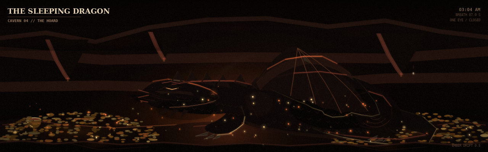
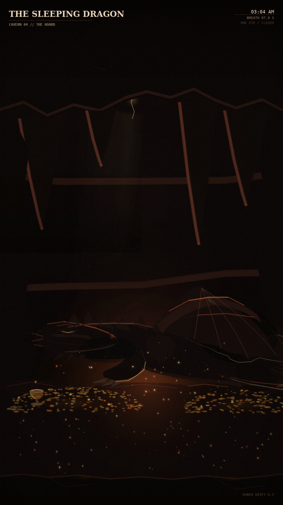
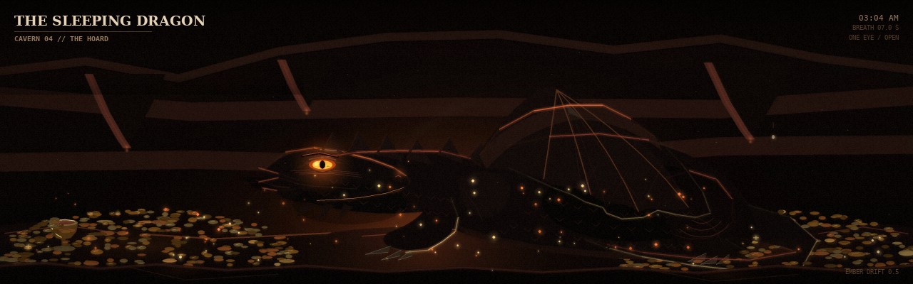

# The Sleeping Dragon — art-direction prototype

Reference: [`SLOW_WORLDS_DESIGN.md` §5.10](../SLOW_WORLDS_DESIGN.md#510-the-sleeping-dragon).

**Status: study only.** This is a still-frame art-direction prototype. It does **not**
add a mode, a registry entry, or a profile slot yet. Nothing in `modes/`,
`modes_registry.json`, `modes_config.json` or `configs/` has been touched.

The generator is [`gen_dragon.py`](gen_dragon.py). Everything is procedural pygame:
no assets, no network, no numpy/PIL. The 1280×400 frame is drawn at 3× and the
1080×1920 frame at 2×, then smoothscaled, bloomed, vignetted and given crisp HUD
text. One canonical dragon is transformed for the portrait so the anatomy is the
same at both ratios.

## The stills

The sleeping pose — 1280×400 Pi strip:



The sleeping pose — 1080×1920 portrait:



The signature moment — one eye open, 1280×400:



## What this establishes

- **Palette.** Ember & Rust: near-black brown background (`#0C0706` family),
  rust structure, gold hoard, amber eye. No fourth hue.
- **Composition.** Two hoard banks left and right, a dark sleeping mass across the
  middle, the head resting at the left, a folded wing over the back, a thick tail
  curling round the rump. The portrait re-anchors into a tall cavern rather than
  cropping the strip.
- **HUD.** Serif title, mono telemetry, one rule, nothing else. `CAVERN 04 // THE
  HOARD` / `03:04 AM` / `BREATH 07.0 S` / `ONE EYE / CLOSED`. The lower-left
  watermark area is deliberately plain rock.
- **Motion cues already in the still.** Breath phase, smoke plume, drifting
  embers, dust, gold glints, cave drips, and the eye event. The open-eye frame is
  a still of the four-second event.
- **The finish.** Cached gradient, warm floor bounce, half-resolution bloom,
  scanlines, vignette, grain. No per-frame assets.
- **The transform bug is fixed.** The portrait uses the same geometry as the
  strip; every detail path now goes through one coordinate transform.

## What is still provisional

- **The creature's head is the weak point.** It currently reads as a stylized
  long-necked beast — crest, wing, tail and claw are doing most of the dragon
  work. Before this becomes code I want a call on whether to push the head
  toward a classic horned dragon, a coiled pose with the head tucked, or keep
  this deliberately abstract silhouette.
- **Hoard density.** The two banks are still fairly even. They can be pushed
  darker and sparser so the gold reads as glints rather than a carpet.
- **Portrait scale.** The primary portrait is the mid-scale re-anchor. A wider
  tall-cavern version is available with `--wide`; a close-up was tried and
  rejected as too much head.
- **Palettes.** Only `ember` has been studied. The card also names `jade` and
  `moonstone`.

## Proposed implementation (after sign-off)

A single-file mode, `modes/sleeping_dragon_mode.py`, class `SleepingDragonMode`
(`__init__(config)`, `enter(manager)`, `exit()`, `handle_event`, `update(dt)`,
`render(screen)`). The renderer from this prototype moves into the mode; if the
file passes ~600 lines it becomes a `sleeping_dragon/` package with the wrapper
following the `space_station/` pattern.

Registry type key: `sleepingdragon`.

| Key | Default | Widget |
|---|---|---|
| `seed` | `null` | number / pin |
| `palette` | `ember` | choice: `ember`, `jade`, `moonstone` |
| `hud` | `minimal` | choice: `minimal`, `off` |
| `quality` | `auto` | choice: `auto`, `low`, `medium`, `high` |
| `breath_period` | `7.0` | 3.0–20.0 s |
| `ember_rate` | `0.5` | 0.0–2.0 |
| `eye_chance` | `0.5` | 0.0–2.0, probability per minute |
| `eye_duration` | `4.0` | 2.0–8.0 s |
| `hoard` | `true` | switch |
| `title` | `THE SLEEPING DRAGON` | text |
| `subtitle` | `CAVERN 04 // THE HOARD` | text |

Planned profile placement after review:

- `configs/modes_config_narrow_horz.json` slot **21** (first free slot).
- `configs/modes_config_vert.json` slot **65** (first free slot), or
  `configs/modes_config_portrait.json` slot **26** if the portrait wall is the
  preferred target.
- Not mirrored into every profile; the design says add only accepted modes and
  keep the existing slot numbering.

Tests: a headless `tests/test_sleeping_dragon.py` covering config validation,
seeded determinism, both render sizes, the eye event timing, and `exit()`
releasing surfaces — plus `python validate_configs.py --all`.

## Run

```bash
# the two review stills
./.venv/bin/python designs/sleeping_dragon_proto/gen_dragon.py

# the signature moment
./.venv/bin/python designs/sleeping_dragon_proto/gen_dragon.py --eye-open

# also the wide tall-cavern portrait
./.venv/bin/python designs/sleeping_dragon_proto/gen_dragon.py --wide

# a flat grey dragon-only study, for the next art pass
./.venv/bin/python designs/sleeping_dragon_proto/gen_dragon.py --study
```

Still frames land in `screenshots/sleeping_dragon/`. The `--study` frames land
beside this README, so the review folder stays limited to the two targets and
the eye-open moment.
