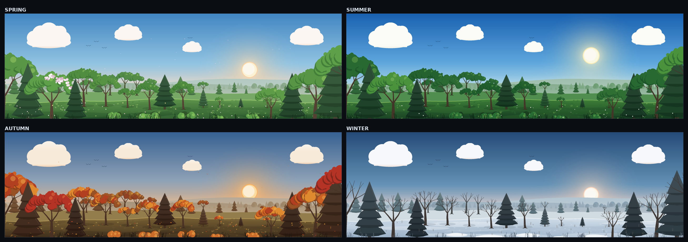
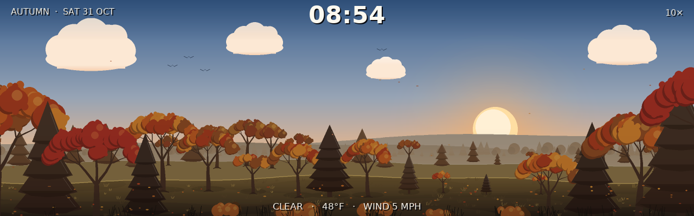
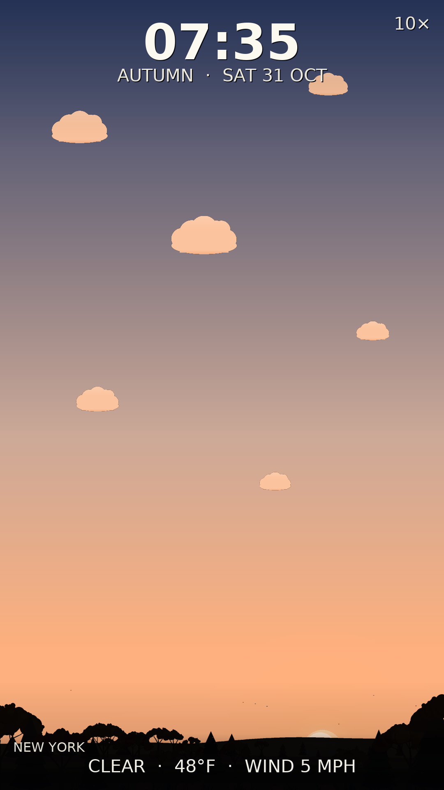
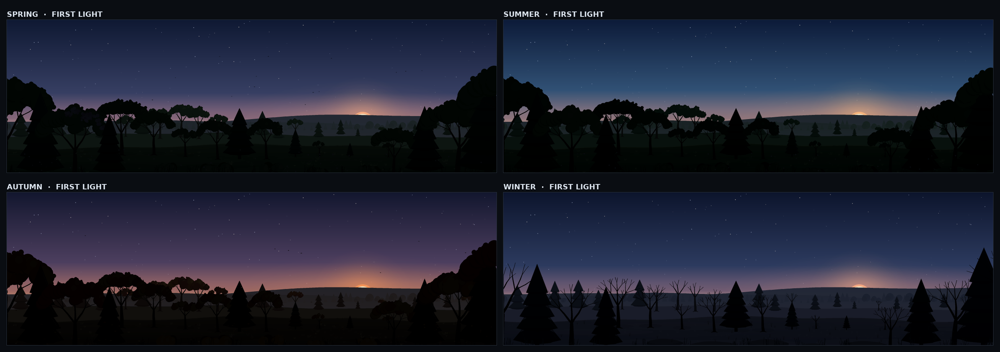
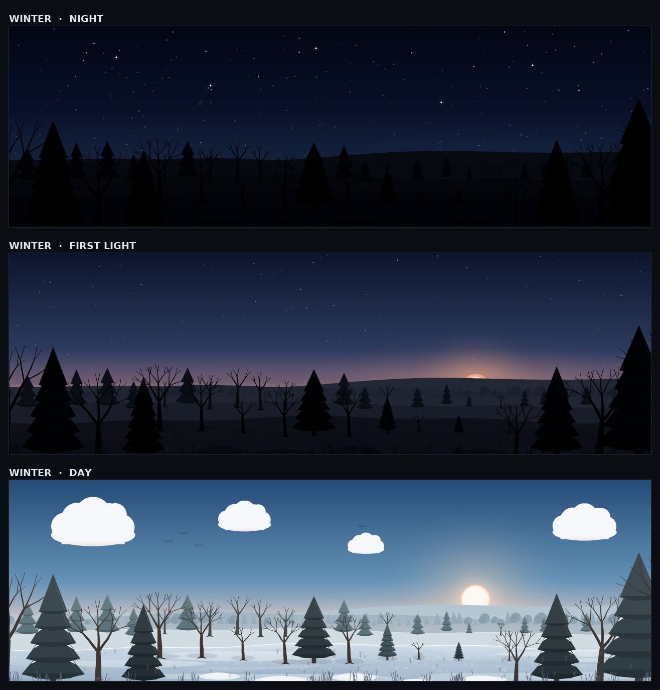
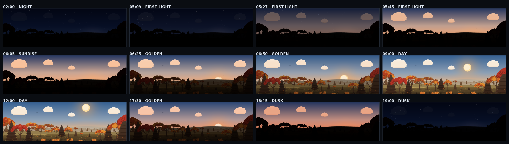

# Sunrise mode — four-season forest study

Prototype art for the sunrise mode. Everything is drawn at **1280×400** (the
narrow Pi kiosk resolution) and is procedural — no image assets, no numpy/PIL.





## Now a mode

`modes/sunrise_mode.py` wraps this art as a kiosk mode (slot **20** in the narrow
profile, slot **64** in the portrait profile). It derives the solar altitude from latitude + date, picks the season
from the calendar (or a pinned override), runs a 1×–10× simulated clock, and
fetches current conditions from Open-Meteo on a background thread for the bottom
line. The art package is `sunrise/` — a 2× extraction of these prototypes so the
mode does not depend on `designs/`; the files in this folder remain the 3× lab.

```bash
# 1280x400 wall
python pixel_dreams.py --config configs/modes_config_narrow_horz.json --play 20 --windowed

# 1080x1920 portrait wall
python pixel_dreams.py --config configs/modes_config_vert.json --play 64 \
    --width 1080 --height 1920 --windowed
```

The shipped profiles use 40.7 / -74.0 as a placeholder location; set latitude,
longitude and units in the panel.

### Portrait

`orientation: "portrait"` (or `auto` on a tall screen) does not crop the 1280x400
frame. The forest stays a band across the bottom of the screen, scaled to the
screen width, and a tall sky grows above it with its own sun path, clouds and
star field. The sun still rises in the landscape's clearing (right of centre)
and drifts left. The HUD stacks the clock and date in the top centre and the
location/weather at the bottom.



## Run

```bash
python designs/sunrise_proto/gen_forest.py            # four day stills + sheets
python designs/sunrise_proto/gen_forest.py --layers   # also dump depth layers

python designs/sunrise_proto/gen_ramp.py --season autumn
python designs/sunrise_proto/gen_ramp.py --season autumn --video
```

`--video` shells out to `/usr/bin/python3` for OpenCV encoding (the runtime venv
does not include OpenCV); the PNG/keyframe outputs work without it.

Outputs (tiles in `seasons/`, contact sheets alongside this README):

| file | what it is |
| --- | --- |
| `spring.png`, `summer.png`, `autumn.png`, `winter.png` | the four day looks |
| `*_dawn.png` | same scene at first light, forest dimmed to a silhouette |
| `winter_night.png` | the night end of the ramp (stars + near-black treeline) |
| `seasons_sheet.png` | 2×2 day contact sheet |
| `dawn_sheet.png` | 2×2 first-light contact sheet |
| `winter_light_cycle.png` | night → first light → day for one season |
| `ramp_<season>.png` | 12-frame time-of-day contact sheet |
| `seasons/<season>_ramp_*.png` | full-size key frames from the ramp |
| `sunrise_<season>.mp4` | 20s time-lapse preview of the full day |







## How it is built

- **One layout, four seasons.** Tree positions, branch skeletons, hills, cloud
  positions and ground curves are generated once from fixed seeds and reused by
  every season. The season only swaps palette + whether foliage hangs on the
  branch tips. A later spring→summer cross-fade therefore cannot jump.
- **Shared tree skeleton.** `grow_tree()` returns tapered branch segments and a
  list of branch tips. Winter draws only the segments (bare tree); spring,
  summer and autumn hang leaf clusters on the same tips. Pines are a separate
  tiered shape.
- **Depth layers.** The scene is five full-size surfaces: `sky`, `far`
  (ridges + distant treeline), `mid` (mid hill + forest band), `ground` (meadow
  or snow), `near` (framing trees, bushes, foreground detail). `compose()`
  stacks them; `tint(layer, mult)` multiplies a layer toward black.
- **Anti-aliasing.** Everything is drawn 3× (3840×1200) and smoothscaled down,
  which is where the soft edges come from.

## Lighting ramp

`gen_ramp.py` drives the same five layers from a solar altitude:

```
alt = sin((phase - 0.25) * 2π)     # 1 at noon, 0 at 06:00 / 18:00, -1 at midnight
```

- Two weights do most of the work: `warm` (sun near/below the horizon) blends
  the season's day sky toward dawn (rising) or dusk (setting); `night` blends
  that toward a starry navy sky. The sun's height, size, colour, glow, horizon
  mist, cloud tint, star alpha and the forest brightness all come from the same
  two weights, so there is one continuous ramp rather than separate states.
- Each forest layer gets a **vertical light gradient**: treetops are brighter
  and warmer, the ground is darker and cooler, and the far layer is lifted a
  little for atmospheric depth. At full day the gradient is neutral, so the
  four day stills are unchanged.
- The sun climbs **vertically with a gentle leftward drift** (70 px at the
  zenith) instead of sitting on one rail. It returns to the gap at dusk, so the
  sunrise and sunset both happen in the clearing.
- The sun is drawn before the forest, so it rises *behind* the treeline and the
  foreground trees occlude it naturally.
- Speed is only a time remap: `phase += dt * speed / 86400`. 1× is wall-clock;
  10× is a 2.4-hour day. The MP4 is a 17-hour preview compressed into 20s
  (≈3000×) so the transition can be judged — not the 10× mode rate.
- Cost: ~0.6s per frame at 3× supersampling (the 12-frame sheet takes ~9s). The
  real mode cannot do that at 60fps; the next step is precomputing a small set
  of lit layer states or moving the grade to the composited frame.

## What is still rough

- Clouds are simple flat-bottomed puffs; the shapes are generic and at dawn
  they all take the same peach tint.
- The meadow is a flat gradient with grass/flowers; it could use stronger tonal
  bands, a path, rocks, or long shadows to sell the perspective.
- Tree crowns are clusters of dabs — readable as cartoon foliage at 1×, but at
  close zoom they are still circles.
- The design-ramp previews still use a fixed 12-hour sine; the mode itself uses
  NOAA solar declination and hour angle, so its winter days are short. Azimuth
  is only expressed as the small left drift, not a full east–west path.
- Between 02:00 and 05:00 every frame is identical: the night sky is static
  once `night` saturates. A little star twinkle or slow cloud drift would keep
  it alive.
- The mode picks its season palette when it starts; it still needs
  interpolation (colour + foliage density) across the year for a long-running
  1× kiosk.
- Portrait 1080x1920 has its own tall-sky composition. Other portrait aspect
  ratios scale from the same band/tall-sky layout but have not had a dedicated
  pass.

## Next

1. A 1× rendering path (composite at 1280×400 instead of 2×) to remove the
   scene-rebuild hitch and make the mode cheap on the Pi.
2. Seasons that interpolate instead of hard-switching, so a 1× kiosk can run
   for months without a restart.
3. Weather that does something visual — overcast greys the sky, rain/snow adds
   particles, wind tilts the grass — instead of only changing the bottom line.
4. A horizontal sun path driven by azimuth, rather than the fixed left drift.
