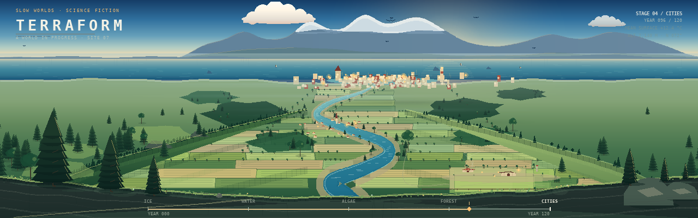
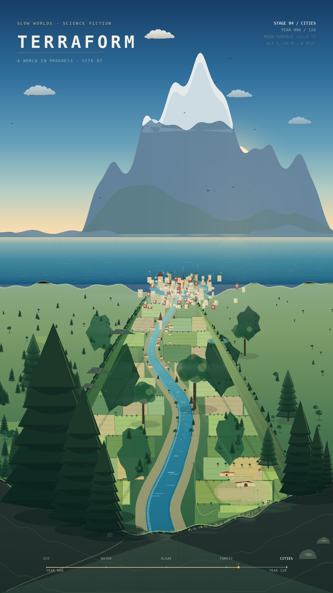

# Terraform — mountain overlook (Slow Worlds 5.15)

Reference: [`SLOW_WORLDS_DESIGN.md` §5.15](../SLOW_WORLDS_DESIGN.md#515-terraform).

**Status: implemented** as the `terraform` mode (`modes/terraform_mode.py` plus
the `terraform/` art package), with registry parameters and instances in the
narrow-horizontal, portrait and vert profiles. The stills below are rendered by
the **real mode**, not by the design generator; the generator remains the
art-direction study that produced the reviewed composition.

The card asks for a world transformed over three minutes: ice retreats, rivers
branch toward the sea, green spreads from the coasts, and city lights appear
along the new waterways. The requested tweak is the camera: not a map view,
but a first-person view from a summit looking **down** into the landscape,
with nearer things drawn larger than farther things.

## The stills

| File | Size | What it is |
|---|---|---|
| [`../../screenshots/terraform/terraform_1280x400.png`](../../screenshots/terraform/terraform_1280x400.png) | 1280×400 | the Pi strip; tree-lined foreground, wide near valley, delta on the horizon |
| [`../../screenshots/terraform/terraform_1080x1920.png`](../../screenshots/terraform/terraform_1080x1920.png) | 1080×1920 | the portrait wall; re-composed so the range fills the upper 40 % |
| [`../../screenshots/terraform/terraform_1920x1080.png`](../../screenshots/terraform/terraform_1920x1080.png) | 1920×1080 | 16:9 sanity still from the landscape preset (not a profile entry) |

**Revision after the first review:** the portrait horizon was moved from
25.5 % to 40 % of the frame, and the range was rebuilt to fill that band. The
near/mid valley layers were re-anchored to the new coastline so no fields or
trees float in the sea. The 1280×400 strip is unchanged.

The strip:



The portrait:



Regenerate the hero stills from the shipping mode:

```bash
SDL_VIDEODRIVER=dummy .venv/bin/python scripts/terraform_preview.py
```

The design study still regenerates the reviewed composition at review
resolution:

```bash
SDL_VIDEODRIVER=dummy .venv/bin/python designs/terraform_proto/gen_terraform.py
```

`gen_terraform.py` is the art-direction study, not the shipping renderer. The
mode caches five stage keyframes instead of rendering one full frame per
screen update.

## What the tweak changed

The card's frame is a flat, world-map-like plate. The requested tweak is a
mountain-top POV, so the still is built as **depth layers**, far to near:

1. **Sky and a rounded snow-capped range.** The far range is a soft, layered
   silhouette; a lower, hazier foothill range sits in front of it. Both meet
   the sea at the horizon.
2. **The bay.** A warm-water estuary with a delta, sandbars, a small lighthouse
   and a dense city at the mouth. The river enters the sea here.
3. **The valley floor.** A perspective patchwork of fields, hedgerows, forest
   patches, roads, a pond, a town and a river. The patchwork follows the
   converging valley sides, so the near fields are wide and the far ones are
   chips.
4. **The left ridge.** A nearer, darker forested wedge. Its crest runs from the
   upper left toward the centre, and its canopy fringe is drawn as individual
   tree silhouettes rather than a smooth arc.
5. **The right ridge.** A farther, sunlit farm ridge, lower and hazier than the
   left one, with a farm, orchard, fields and a silo.
6. **The summit itself.** A dark rock shelf across the bottom of the frame,
   with a grass lip, a footpath, a cairn, boulders and three big pines. This is
   the near edge of the viewpoint; the controller's 80×32 lower-left corner
   stays dark and detail-free.

## How the near/far logic is drawn

The still uses five reinforcing cues, so the landscape reads as depth rather
than as a map:

- **Object scale.** A field, tree, building or wave gets smaller with its
  screen position: the near farm is a cluster of readable buildings, the middle
  town is a row of small roofs, the delta city is a warm constellation of
  dots. The foreground pines are roughly 30× the height of a far tree.
- **River taper.** The river is ~38 screen pixels wide at the bottom of the
  strip and a thread at the delta. Its banks and glints taper with it.
- **Occlusion.** The left and right ridges overlap the valley; the foreground
  shelf overlaps both. The river disappears behind the near shelf and re-enters
  the valley in the middle distance.
- **Aerial perspective.** The far half of the valley is hazed toward the sky,
  the far ridge is cooler and lower-contrast than the near one, and the far
  range is paler than the foothills. The near shelf and pines are the darkest
  values in the frame.
- **Perspective patchwork.** Field rows are laid out between the converging
  ridge boundaries, so the valley widens toward the viewer. The farm's road
  follows the river toward the delta, and the tree rows converge with it.

## The two orientations

The portrait is a **re-composition, not a crop**:

- the horizon is much lower in the frame (40 % vs 27 %), so the range and the
  sky above it fill the top 40 % and the mountains are taller; the valley below
  is re-composed rather than squeezed, and the foreground pines are larger;
- the title lockup is a single 56 px tracked line with the eyebrow above it,
  and telemetry in the top-right; the strip uses a 27 px title;
- the timeline is a full-width footer in both, but the portrait has more air
  around it;
- the lower-left 80×32 controller watermark area is kept clear in both.

## What the still is showing

This is **stage 04 / CITIES**, at **year 096 of 120** (80 %). The world is
late in its transformation:

- ice survives only on the far peaks; the valley is green and farmed;
- the river runs from the foreground to a wide delta;
- the delta city is lit and the farm/town are inhabited;
- the timeline shows the five stages (ICE, WATER, ALGAE, FOREST, CITIES) with
  the current marker at 80 %.

The still is one frame of the long cycle. The mode will animate the retreat of
the ice, the growth of the river network, the spread of vegetation and the
appearance of city lights; the timeline is part of the HUD, not the mechanism.

## Palette

`biosphere` is the reviewed palette: a cool, luminous dawn, a warm sun in a
saddle of the range, saturated greens in the valley, hazy blue distance and
warm city lights. The design card also names `ice` and `desert`; those are
palette variants for the mode, not new layouts.

## Tuning levers now that it is running

1. **Camera pitch.** The portrait now uses the reviewed 40 % mountain band.
   This is a one-number change in `terraform/art.py` if it needs another pass.
2. **Foreground weight.** Are the summit shelf and the three pines the right
   amount of frame, or should the pines be smaller and the valley more open?
3. **Middle distance.** Does the perspective patchwork read as farmland, or is
   it still too map-like? More forest and fewer fields would make it lusher;
   more fields would make the terraforming more explicit.
4. **Delta.** Is the city at the river mouth the right size and character? It is
   deliberately a warm, low cluster with a small lighthouse, not a skyline.
5. **Light.** Is the cool-dawn / warm-sun split the right mood, or do you want
   the brighter, flatter daylight of Sunrise as the default?
6. **Silhouette.** Should there be a human or science-fiction anchor on the
   summit (a survey mast, a terraforming beacon), or should the POV stay purely
   landscape?
7. **Stage.** Is the late-stage / cities frame the right hero still, or should
   the reviewed image show an earlier stage where the ice and rivers are more
   legible?
8. **Portrait.** Is the portrait's single-line title and footer the right
   lockup, or should it use a two-line title like Leviathan and the Orrery?

## How the mode was added

The shipping implementation is:

- **`modes/terraform_mode.py`** — the mode wrapper: config, the five-stage
  cycle, crossfades, cached keyframes, quality, HUD, resize, overlays, stats
  and the error panel.
- **`terraform/art.py`** — the renderer. It is the reviewed layered scene
  (range, bay, valley patchwork, two ridges, summit) with the stage rules and
  palette variants. It is pure pygame: no assets, no network, no disk I/O.
- **`modes_registry.json`** — the `terraform` type, with the complete
  `optional`/`params` block.
- **Profiles** — slot **26** in `configs/modes_config_narrow_horz.json`,
  slot **31** in `configs/modes_config_portrait.json`, and slot **70** in
  `configs/modes_config_vert.json`. `modes_config.json` is unchanged; the
  default profile does not gain the mode unless you ask for it.
- **`tests/test_terraform.py`** — 39 cases covering the four aspect targets,
  the 40 % portrait horizon, seed reproducibility, stage timing, palettes,
  quality, HUD/corner clearance, bad configs, resize/exit and the three profile
  instances.
- **`scripts/terraform_preview.py`** — the two hero stills plus the 16:9 sanity
  still, rendered by the real mode.

### Stage cycle

`cycle_seconds` defaults to 180 s and is divided evenly into five stages:
ICE, WATER, ALGAE, FOREST, CITIES (36 s each at the default). The last 10 s of
each stage crossfades into the next; `start_stage` enters at 0–4. The year bar
maps 0–120 onto the cycle, so the reviewed frame is stage 04 / CITIES at year
096.

The keyframes change the land cover, not just a colour overlay:

- ICE: bleached valley, snow fields and a thin frozen river; no fields,
  forests or settlements.
- WATER: the snow breaks up, the river runs full and the hills are still bare.
- ALGAE: green returns in patches; sparse vegetation on the ridges.
- FOREST: fields, hedgerows, forest patches, the farm, the town and the delta
  buildings appear; no city lights.
- CITIES: warm windows, the delta constellation and the harbour light.

### Rendering and quality

Five stage frames are rendered once on entry at an internal resolution chosen
by `quality`:

| Setting | Internal scale | What changes |
|---|---:|---|
| `low` | 0.55 | coarser keyframe, fewer glints/lights |
| `medium` | 0.75 | the default for `auto` |
| `high` | 1.0 | native keyframe, full overlay detail |

`auto` starts at medium and adjusts the *overlay* detail (birds, river glints,
light count) to the measured frame time; it does not rebuild the keyframes, so
the composition and timing never pop. Fixed settings choose the keyframe scale
at entry.

Per frame the mode blits one cached stage frame (or two, during a crossfade),
then draws only the river glints, birds, city-light twinkle and the timeline.
The lower-left 80×32 px is kept clear; the timeline starts at x ≥ 140.

### Palette variants

`biosphere`, `ice` and `desert` are full palette tables; the geometry, layers
and stage rules are shared. The stage palette bleaches toward ice for ICE/WATER
and toward algae for ALGAE, then returns to the variant's reviewed palette for
FOREST/CITIES.

### Checks run

```bash
.venv/bin/python validate_configs.py --all
SDL_VIDEODRIVER=dummy .venv/bin/python -m pytest tests/ -q
SDL_VIDEODRIVER=dummy .venv/bin/python scripts/terraform_preview.py
```

All three are green as of this writing (the only validator warning is the
pre-existing Windows `boot_ticker` path in `modes_config_portrait.json`).

## Scope notes

- The mode is five cached stage keyframes plus lightweight animation, not
  twenty separate scenes.
- No new dependency: the art is pygame only, with no assets and no network.
- The design generator is not the shipping renderer; it remains the review
  study for the reviewed composition.
- `modes_config.json` is intentionally unchanged; Terraform is in the narrow,
  portrait and vert profiles at slots 26, 31 and 70.
